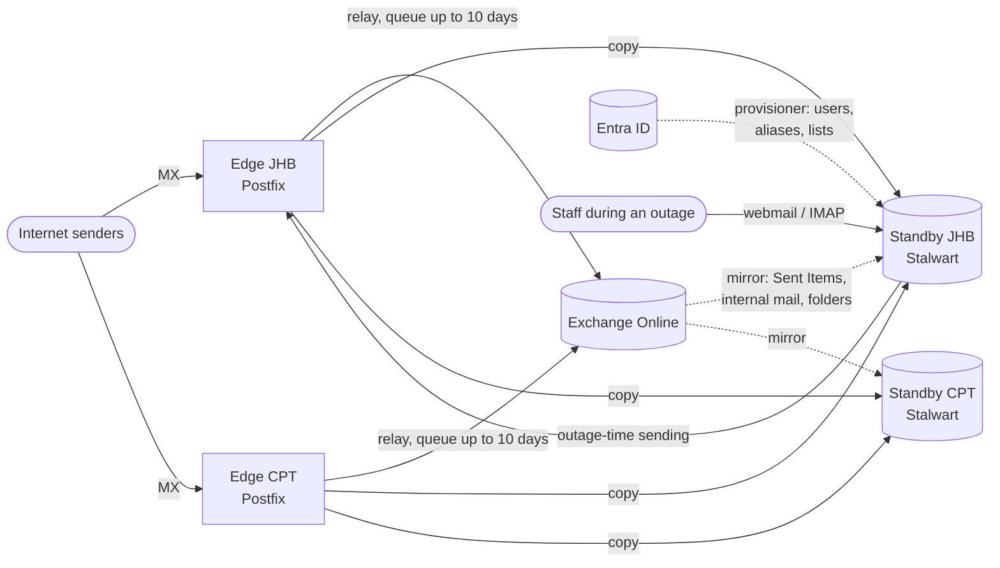

# ZA Mail: design

As of 13 November 2026.

ZA Mail is a second, independent mail system that runs beside Microsoft 365 and takes over
when Microsoft is down. It is built from open-source software and runs in South African
data centres or on the customer's own hardware.

This document explains the design. The runnable kit is in this repository; the
[README](../README.md) shows how to try it locally.

## 1. The problem

On 12–13 November 2026 Exchange Online was unavailable for hours across multiple regions.
Microsoft attributed it to infrastructure under elevated load, not an attack
([CNN live coverage](https://www.cnn.com/2026/11/12/business/live-news/microsoft-global-outage-intl-hnk),
[Newsweek](https://www.newsweek.com/microsoft-outlook-down-not-working-incident-server-12707459)).
Teams and SharePoint were affected too, so the usual fallback of "message people on Teams"
was not available either.

A company with all its mail in Microsoft 365 has three single points of failure:

| Dependency | What breaks when it fails |
|---|---|
| Exchange Online | Reading and sending mail. |
| Entra ID (sign-in) | Everything, even when the mail servers are healthy. |
| Microsoft's MX endpoint | Inbound mail waits at the sender; nobody can see it. |

Mail is rarely lost in an outage, because sending servers retry for days. The damage is
that staff cannot read or send anything for the duration. ZA Mail removes that.

## 2. What ZA Mail does

Four decisions define the design.

1. **ZA Mail owns the front door.** The domain's MX records point at ZA Mail, not at
   Microsoft. Inbound mail keeps arriving whatever state Microsoft is in.
2. **Every inbound message is delivered twice.** One copy is relayed to the user's
   Microsoft 365 mailbox, one goes to a ZA Mail mailbox. The standby is already current
   when it is needed.
3. **Failover needs no DNS change.** Users open ZA Mail webmail or a mail app that was set
   up beforehand. Nothing has to propagate.
4. **Sign-in does not touch Microsoft.** ZA Mail has its own passwords and second factor.

On a normal day users notice nothing: they work in Outlook as before.

### Out of scope

Teams, SharePoint and OneDrive. Calendars and contacts are supported by the mail server
(CalDAV, CardDAV) but are not synchronised from Microsoft 365 in this version.

## 3. Architecture

Solid lines carry live mail. Dotted lines are background jobs that only run while
Microsoft 365 is healthy.

| Component | Software | Job |
|---|---|---|
| Edge | Postfix | The MX. Accepts mail for the customer's domains, relays it to Exchange Online, and sends a copy to each standby. Holds mail for Exchange Online in a queue while it is down. |
| Standby | Stalwart (Community, AGPL-3.0) | Mailboxes, IMAP, sending, spam filter, its own user directory. |
| Webmail | Roundcube | What most users open during an outage. |
| Mirror | `sync/mirror.py` (our own IMAP copier, Python standard library) | Copies Sent Items, mail between colleagues and folders from Microsoft 365 into the standby. |
| Provisioner | `sync/provision.py` | Keeps standby accounts and the edge's list of valid recipients in step with Entra ID. |
| Probe | `probe/probe.py` | Detects an outage, raises the outage flag, triggers the SMS/WhatsApp notice. |

### Why these choices

- **Postfix at the edge.** The edge is the only ZA Mail component on the normal-day mail
  path, so it must be the most proven part. Stalwart cannot both store a message and relay
  it for the same recipient: its routing picks one destination per recipient
  ([Stalwart routing](https://stalw.art/docs/mta/outbound/routing/)). Postfix does this
  with two standard features, `recipient_bcc_maps` and `transport_maps`.
- **Stalwart for the standby.** One program provides IMAP, sending, spam filtering and
  the user directory, and it can be configured entirely from scripts. Version 1.0 was
  released on 26 October 2026, so it is young; the kit pins an exact version (1.1.0) and
  keeps Stalwart off the normal-day path.
- **Not Dovecot.** Dovecot's community edition removed replication in version 2.4
  ([upgrade notes](https://doc.dovecot.org/main/installation/upgrade/2.3-to-2.4.html)),
  which removes its main advantage for a two-site standby.
- **One instance per customer.** Stalwart's multi-tenancy is a paid feature
  ([edition comparison](https://stalw.art/compare)). ZA Mail gives each customer its own
  edge and standby instead. Isolation is stronger, and hosted and on-premise installs are
  the same thing.
- **Docker Compose and Ansible, not Kubernetes.** A customer instance is four containers.
  An on-premise IT team can run that without a cluster.

### The edge must not change messages

The edge adds no footers, tags or rewrites. Messages reach Exchange Online byte-for-byte
as sent, so DKIM signatures stay valid and Microsoft's filtering works as before.

## 4. Mail flow

### Normal day

1. A sender looks up the MX and connects to a ZA Mail edge.
2. The edge checks the recipient against the list from the provisioner. Unknown addresses
   are refused immediately.
3. The edge relays the message to Exchange Online over TLS and, separately, delivers a
   copy to each standby node. Each destination has its own queue, so a slow or dead
   destination never delays the others.
4. Every 10 minutes the mirror copies recent Sent Items and other folders from
   Microsoft 365 into the standby. A full pass runs nightly.

### During a Microsoft outage

1. The edge keeps accepting mail. Copies reach the standby at once. The Exchange Online
   copies wait in the edge queue (kept for 10 days).
2. The probe sees three failed checks in a row, raises the outage flag and sends the
   notice. The mirror stops while the flag is set.
3. Staff open webmail. Their recent mail is there and new mail keeps arriving.
4. Mail they send goes out through the edge, DKIM-signed, from IP addresses already
   listed in the domain's SPF record.

### Fail-back

1. Microsoft recovers. The edge queue drains by itself.
2. A person, not the probe, decides the outage is over.
3. `sync/failback.py` copies outage-time Sent Items and internal mail from the standby
   into Microsoft 365. It compares Message-Ids, so nothing is added twice.
4. The flag is cleared and the mirror resumes.

Read state, deletions and folder moves made on the standby are not copied back. Staff are
told this in the outage notice.

Step-by-step procedures are in [runbooks/](runbooks/).

## 5. Keeping the standby current

Inbound mail arrives through the edge in real time. Everything else comes from the mirror.

| Mail | How it reaches the standby | How fresh |
|---|---|---|
| From outside | Edge copy | Immediate |
| Sent by the user from Outlook | Mirror | Up to 10 minutes old |
| Between colleagues (never leaves Microsoft) | Mirror | Up to 10 minutes old |
| Older mail and folders | Nightly full mirror | Up to a day old |

The mirror follows three rules:

- **Additive only.** It never deletes or moves anything. A half-working Microsoft 365 that
  shows empty folders cannot wipe the standby.
- **Paused during an outage.** It does nothing while the outage flag is set.
- **No duplicates.** The same message often arrives twice, once from the edge and once
  from the mirror. They are matched on the Message-Id header.

The mirror is ZA Mail's own code (`sync/zimap.py`), not a third-party sync tool, so every
component in the kit carries an OSI-approved licence.

Two alternatives were rejected. Exchange journaling needs a custom unwrapping service and
carries no folder information. Routing Microsoft's outbound mail through the edge misses
mail between colleagues entirely.

Known limitation: when a user files a message into a folder in Outlook, the mirror adds it
to that folder on the standby, and the original edge copy also stays in the standby Inbox.

## 6. Identity

ZA Mail keeps its own directory inside the standby. Nothing at sign-in calls Microsoft.

- **Accounts** are created by the provisioner from Entra ID (through Microsoft Graph) or
  from an exported file. The directory is stored locally, so it keeps working when Entra
  ID is down.
- **Passwords** are separate from Microsoft passwords. Microsoft does not release password
  hashes, so this cannot be avoided. New accounts get a one-time password that the user
  changes at enrolment.
- **Second factor:** TOTP, set by each user. Mail apps then use app passwords.
- **Customers with on-premise Active Directory** can have Stalwart check passwords against
  it over LDAP instead. Stalwart does not offer its own second factor on that path.

**Enrolment is the weak point of any standby.** A user who has never signed in to ZA Mail
cannot start during an outage, because password-reset emails are not reaching them.
Onboarding is not complete until every user has signed in once; the onboarding runbook
makes this a gate.

Stalwart can also accept SCIM provisioning pushed from Entra ID. The kit uses its own
provisioner instead because the same run must also update the edge's recipient list.

## 7. Microsoft 365 configuration

Scripts are in [`exo/`](../exo/). They have not been run against a live tenant yet.

| Setting | Value | Why |
|---|---|---|
| Accepted domains | Authoritative | Any relay type would send unknown recipients back out to the MX, which is now the edge: a loop. |
| Inbound connector | Partner type, all sender domains, TLS required, identified by the edge's certificate | Tells Exchange Online that internet mail arrives through the edge. |
| Enhanced Filtering | Skip-list of edge IPs | Microsoft then checks SPF and DMARC against the real sender, not the edge ([Microsoft docs](https://learn.microsoft.com/en-us/exchange/mail-flow-best-practices/use-connectors-to-configure-mail-flow/enhanced-filtering-for-connectors)). |
| Connector restriction | On, after MX cut-over | Rejects mail delivered straight to Microsoft, which would bypass the edge and never reach the standby. |
| App registration | `IMAP.AccessAsApp`, Graph `User.Read.All` and `Group.Read.All` | Mirror, fail-back and provisioner ([Microsoft docs](https://learn.microsoft.com/en-us/exchange/client-developer/legacy-protocols/how-to-authenticate-an-imap-pop-smtp-application-by-using-oauth)). |
| Journal rules | None | Not used. |

The app is granted FullAccess only on mailboxes in one named group. Its secret can read
all of those mailboxes, so it lives only on the ZA Mail host and is rotated on a schedule.

Microsoft's own description of this pattern:
[Manage mail flow using a third-party cloud service](https://learn.microsoft.com/en-us/exchange/mail-flow-best-practices/manage-mail-flow-using-third-party-cloud).

## 8. DNS and sending reputation

- **Hosting.** Use two independent DNS providers, neither of them Azure DNS. Publish the
  MX, webmail and IMAP names on both.
- **MX.** Two records, one per edge site, equal priority. They never change at failover.
- **SPF.** Add the edge IP addresses alongside Microsoft's include.
- **DKIM.** The standby signs with its own selector. Publish it during onboarding.
- **DMARC.** Works unchanged; both sending paths are aligned.
- **MTA-STS and TLS-RPT.** List the edge hostnames in the policy.

**Cold IP addresses.** During an outage a whole company suddenly sends from addresses that
have never sent mail, and receivers may throttle them. The remedy is to route a small
pilot group's outbound mail through the edge every day, using a rule-scoped outbound
connector in Exchange Online. This is designed but **not built in this version**: it needs
the edge to accept relay from Microsoft by certificate.

## 9. Hosting in South Africa

ZA Mail needs ordinary Linux servers with public IPv4 addresses, port 25 open in both
directions, and control of reverse DNS. Any of the following works:

- **Carrier-neutral colocation**, for example Teraco, Africa Data Centres or Open Access
  Data Centres, each with sites in Gauteng and the Western Cape. Verify current sites with
  the operator.
- **A local hosting or cloud provider** that allows outbound port 25 and custom reverse DNS.
- **On-premise**, on the customer's own hardware and internet links.

Do not host ZA Mail on Azure. The point is independence from Microsoft.

Put the two sites on different networks and power, ideally in different cities
(Johannesburg and Cape Town). For an on-premise install, use the customer's site plus one
hosted site.

### Deployment tiers

| Tier | Layout | Survives |
|---|---|---|
| 1. Single site | Two edges, one standby, backups | Microsoft outage. A standby failure during an outage means no mail access. |
| 2. Dual standby (recommended) | Two edges, two independent standby nodes | Microsoft outage plus the loss of a whole site. |
| 3. Clustered | Stalwart cluster on PostgreSQL or FoundationDB with shared object storage | As tier 2, with one consistent mailbox. Documented here only; not built. |

In tier 2 each standby node receives every message from both edges and runs its own
mirror, so the nodes hold the same mail without any replication between them. Users are
pointed at one node. The other is the spare: mail sent or filed on the first node during
an outage is not on the second. Tier 3 removes that gap at the price of running several
distributed systems, which is hard to justify for a standby.

## 10. What users experience when things fail

| Failure | What users see |
|---|---|
| Exchange Online down | Outlook stops. Webmail on ZA Mail has their mail; new mail keeps arriving; sending works. |
| Entra ID down | The same. ZA Mail sign-in is unaffected. Mirror and provisioner pause until it returns. |
| One ZA Mail site down | Nothing. The other MX takes inbound mail. |
| ZA Mail fully down, Microsoft up | Inbound mail waits at senders (typically 4–5 days of retries). Mail inside Microsoft 365 still works. The break-glass runbook points MX back at Microsoft. |
| One DNS provider down | Nothing. |
| Microsoft and ZA Mail both down | No mail. Inbound waits at senders. |

The fourth row is the cost of this design: ZA Mail becomes part of the normal-day inbound
path. That is why the edge is two independent sites running the simplest possible
software, and why the break-glass procedure exists and must be rehearsed.

## 11. Security and compliance

- **POPIA.** Mailbox data stays in South Africa. A hosting provider running ZA Mail for a
  customer is an operator under POPIA and needs a written operator agreement.
- **Encryption in transit.** TLS is required to Exchange Online and offered to all senders.
- **Encryption at rest.** Use full-disk encryption on the hosts. Stalwart can also encrypt
  each mailbox with the user's own key.
- **Exposure.** Only ports 25 (edge), 443, 465 and 993 (standby) face the internet. The
  standby's port 25 and admin port are private.
- **Standby spam filtering is weaker than Microsoft's.** The standby sees the edge's IP
  address, not the sender's, so it cannot check SPF. It still checks DKIM and DMARC and
  runs its content filter. Expect more junk in standby mailboxes than in Outlook.
- **Privileged secrets.** The Microsoft app secret and the ZA Mail service account can
  open every mailbox. Keep them in the host's `.env` (mode 600) or a vault, and rotate them.
- **Client warning.** The new Outlook for Windows syncs IMAP accounts through Microsoft's
  cloud, so it cannot be the outage client. Use webmail, classic Outlook, Thunderbird or
  the phone's built-in mail app.

## 12. Risks

1. **The edge is a normal-day dependency for inbound mail.** A mistake in the connector
   restriction can reject mail. Mitigation: two sites, staged cut-over, rehearsed break-glass.
2. **Users who never enrolled cannot get in on the day.** Mitigation: enrolment gate and a
   quarterly sign-in drill.
3. **The mirror is the most fragile part.** It depends on IMAP access that Microsoft
   throttles and on tokens from Entra ID. It is additive-only so that its failures cost
   freshness, never data.
4. **Stalwart 1.x is new.** Mitigation: pinned version, kept off the normal-day path,
   upgrades tested in the development stack first.
5. **Cold sending addresses** during an outage (section 8).
6. **Stalwart is a single-vendor project.** It is dual-licensed: AGPL-3.0 for the Community
   edition, a proprietary licence for Enterprise features. ZA Mail uses only the AGPL side
   and runs it unmodified, so the AGPL places no burden on ZA Mail's own Apache-2.0 code.
   The vendor could move features between editions in a later release. Mitigation: the
   version is pinned, and the mailbox server is the replaceable part of the design.

## 13. Status of this kit

| Part | Status |
|---|---|
| Edge, standby, webmail, dual delivery, queueing, outage-time sending | Built. See the README for the current local test results. |
| Mirror, probe, fail-back | Built. See the README for the current local test results. |
| Provisioner from a file | Built and used by the development stack. |
| OAuth token helper, mirror over IMAP with app-only OAuth | Proven on a live tenant (one mailbox, 47,633 messages, November 2026). |
| Provisioner from Microsoft Graph | Written, not run against a live tenant. |
| `exo/New-ZaMailApp.ps1`, `exo/Test-ZaMailApp.ps1` | Proven on a live tenant. |
| `exo/Set-ZaMailConnector.ps1` | Written and syntax-checked, not run against a live tenant. |
| Production Compose files for the standby | Running on a real host (one server, webmail public, admin private). |
| Production Compose files for the edge, Ansible roles | Written, not run on real hosts. |
| Copying the recipient list from the standby host to separate edge hosts | Not built. On separate hosts, sync `/etc/zamail/recipients` to each edge (for example rsync over SSH after each provisioner run). |
| Outbound warm-up route, calendar and contact sync, clustered tier | Designed, not built. |

## 14. Open decisions

- **Hosted sending addresses.** One set of IP addresses per customer gives clean isolation
  but they start cold. A shared, warm relay pool sends better but mixes customers'
  reputation. The kit assumes per-customer addresses.

## 15. Sources

- Outage: [CNN](https://www.cnn.com/2026/11/12/business/live-news/microsoft-global-outage-intl-hnk), [Newsweek](https://www.newsweek.com/microsoft-outlook-down-not-working-incident-server-12707459), [Variety](https://variety.com/2026/digital/news/outlook-outage-microsoft-email-down-1236946411/)
- Stalwart: [edition comparison](https://stalw.art/compare), [declarative deployments](https://stalw.art/docs/configuration/declarative-deployments/), [routing](https://stalw.art/docs/mta/outbound/routing/), [two-factor authentication](https://stalw.art/docs/auth/authentication/2fa/), [clustering](https://stalw.art/docs/cluster/overview/)
- Microsoft: [third-party mail flow](https://learn.microsoft.com/en-us/exchange/mail-flow-best-practices/manage-mail-flow-using-third-party-cloud), [Enhanced Filtering for Connectors](https://learn.microsoft.com/en-us/exchange/mail-flow-best-practices/use-connectors-to-configure-mail-flow/enhanced-filtering-for-connectors), [OAuth for IMAP](https://learn.microsoft.com/en-us/exchange/client-developer/legacy-protocols/how-to-authenticate-an-imap-pop-smtp-application-by-using-oauth), [journaling](https://learn.microsoft.com/en-us/exchange/security-and-compliance/journaling/journaling)
- Dovecot: [2.3 to 2.4 upgrade notes](https://doc.dovecot.org/main/installation/upgrade/2.3-to-2.4.html)
